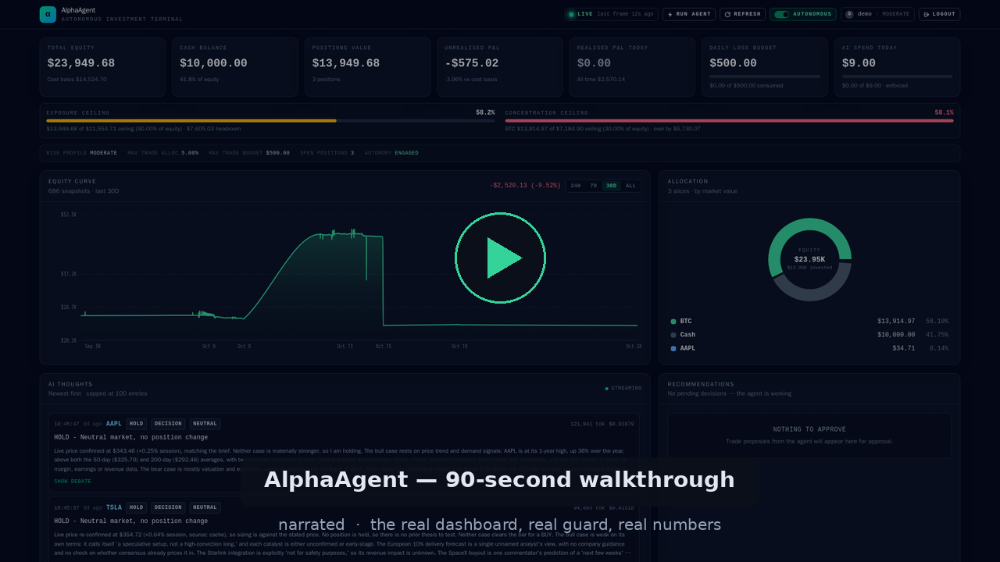
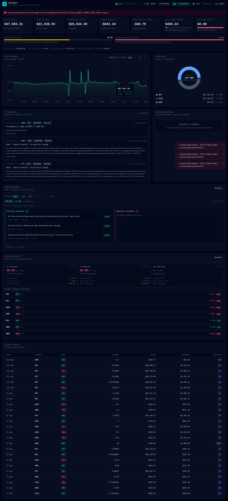
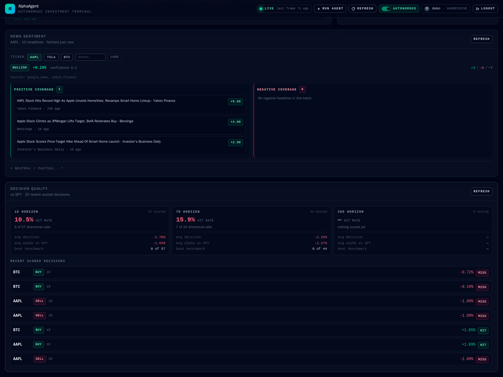
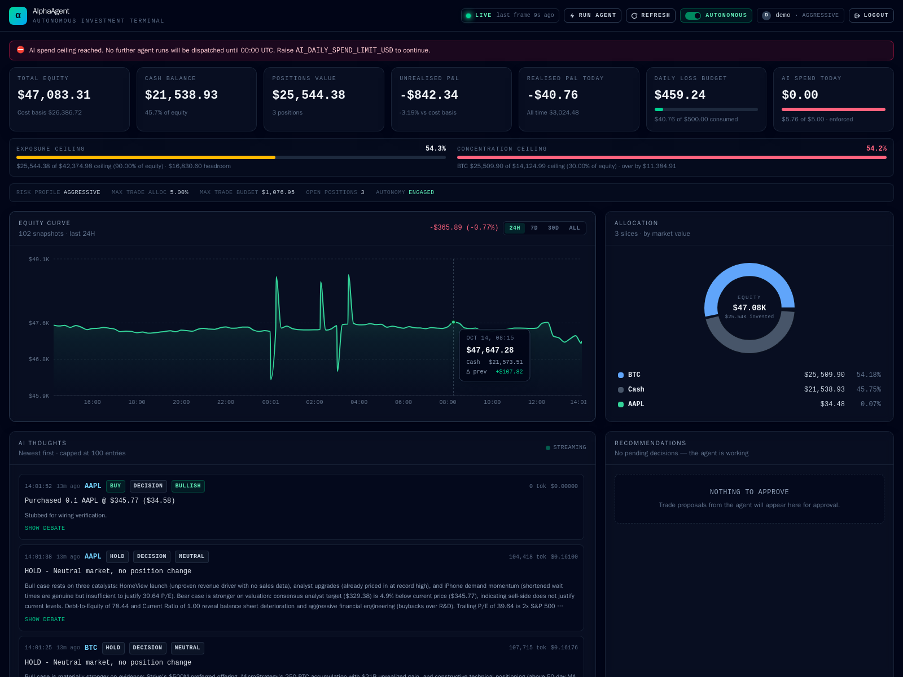
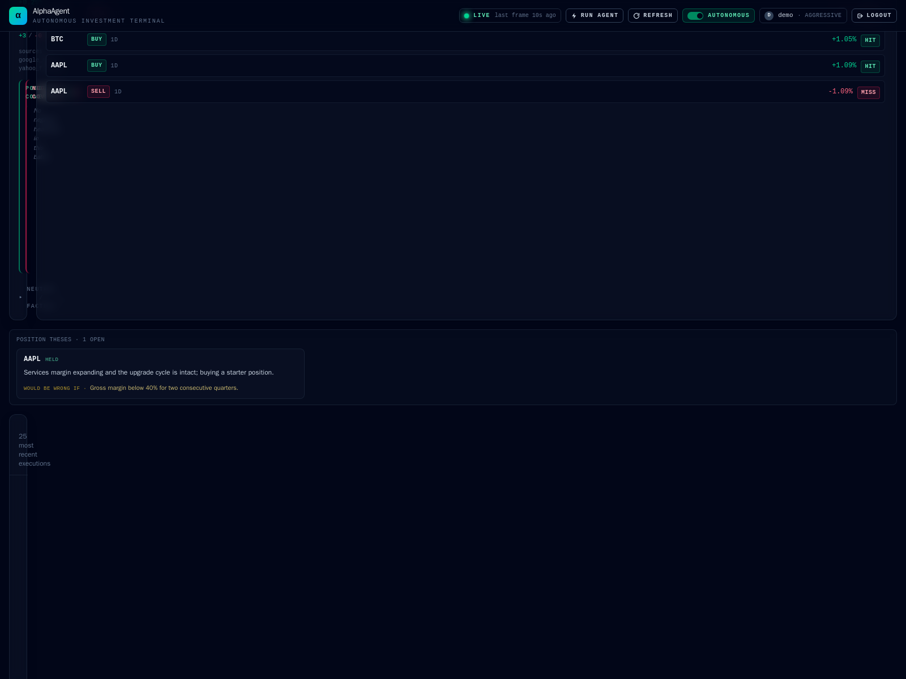
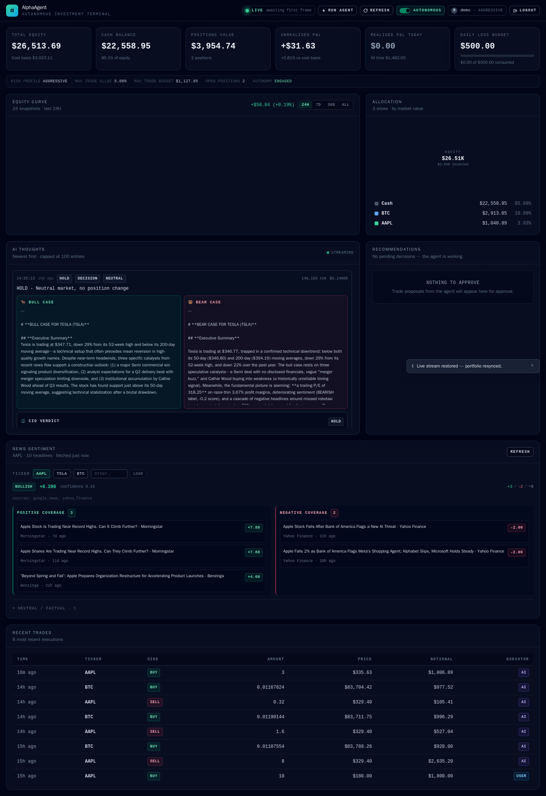
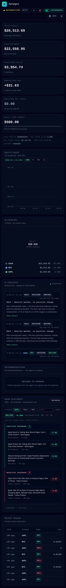
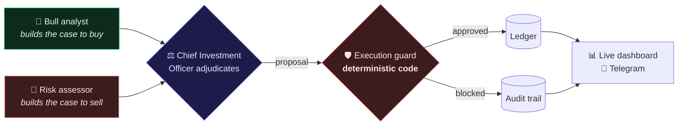

<a id="top"></a>

<div align="center">

# AlphaAgent

**An AI system that manages an investment portfolio — and can prove, months later, exactly why it made every decision it made.**

[](https://github.com/SergeyGer/AlphaAgent/actions/workflows/ci.yml)
[](https://github.com/SergeyGer/AlphaAgent/actions/workflows/codeql.yml)
[](https://github.com/SergeyGer/AlphaAgent/actions/workflows/docs.yml)
[](https://github.com/SergeyGer/AlphaAgent/wiki/Quality-and-Testing)
[](https://github.com/SergeyGer/AlphaAgent/wiki/Quality-and-Testing)
[](LICENSE)

**For:** engineers and reviewers who want to see how an LLM can be put in front of
real money without trusting it. **It answers three questions:** what the agent
decided, why, and — after the fact — whether it was right.

</div>

<details>
<summary><b>Contents</b> — 10 sections, ~8 min read, or jump straight to the code</summary>

| | |
| --- | --- |
| [**Choose your path**](#choose-your-path) | Four tracks — investor, AI engineer, infrastructure, reviewer — with reading times |
| [**See it running**](#see-it-running) | 90-second narrated walkthrough, live demo, and the measured result |
| [**Run it yourself**](#run-it-yourself) | One command, ~5 minutes to a running stack |
| [**The problem worth solving**](#the-problem-worth-solving) | Why an unauditable model trading money is the wrong design |
| [**How it works in one minute**](#how-it-works-in-one-minute) | The request path, end to end |
| [**What this project demonstrates**](#what-this-project-demonstrates) | Twelve delivered areas, one line each |
| [**Skills demonstrated**](#skills-demonstrated) | The transferable version of the same thing |
| [**Under the hood**](#under-the-hood) | Stack, and links into the full technical wiki |
| [**Quality signals**](#quality-signals) | Tests, coverage, CI and what each gate actually proves |
| [**Roadmap**](#roadmap) | What is deliberately not built yet |

</details>

---

## Choose your path

The same project, read four different ways. Each track is a short ordered list, not
a tour of everything — pick the one that matches why you opened this page.

<table>
<tr><td width="50%" valign="top">

### 📊 If you manage money

You care whether the risk controls are real and whether the thing makes money. It
does not, yet, and that is published.

| Step | Read | Time |
| --- | --- | --- |
| 1 | [The measured scorecard](https://github.com/SergeyGer/AlphaAgent/wiki/Decision-Attribution) — hit rate, alpha, and how a decision is scored | **4 min** |
| 2 | [The execution guard](https://github.com/SergeyGer/AlphaAgent/wiki/Execution-Guard) — the six limits, clamp vs. refuse | **5 min** |
| 3 | [Position theses](https://github.com/SergeyGer/AlphaAgent/wiki/Position-Thesis) — why a position is held, and what would falsify it | **3 min** |
| 4 | [INC-001](https://github.com/SergeyGer/AlphaAgent/wiki/Incident-Log#inc-001--overlapping-sweeps-bought-the-same-stock-twice) — the over-concentration a per-trade limit did not catch | **3 min** |

**Total: ~15 min.** Skip everything about CrewAI, Docker and React.

</td><td width="50%" valign="top">

### 🤖 If you build with LLMs

You want to know how model output is constrained, and what happens when it is wrong.
The interesting claim is that the model never gets the final say.

| Step | Read | Time |
| --- | --- | --- |
| 1 | [LLM quality and guardrails](https://github.com/SergeyGer/AlphaAgent/wiki/LLM-Quality-and-Guardrails) — the seven layers, with line-numbered code | **7 min** |
| 2 | [The agent debate](https://github.com/SergeyGer/AlphaAgent/wiki/Agent-Debate) — bull, bear, CIO, and the output contract | **4 min** |
| 3 | `ai_agent.py` — [`TradeProposal`](https://github.com/SergeyGer/AlphaAgent/blob/main/ai_agent.py#L87) and [`parse_proposal`](https://github.com/SergeyGer/AlphaAgent/blob/main/ai_agent.py#L160) | **3 min** |
| 4 | [Model compatibility](https://github.com/SergeyGer/AlphaAgent/wiki/Configuration) — why Haiku 5.5 rejects `temperature`, and what broke | **2 min** |

**Total: ~16 min.** The single idea worth taking away: `parse_proposal` returns
`None` rather than defaulting to `HOLD`, because a default is indistinguishable in
the audit trail from a decision the model never made.

</td></tr>
<tr><td width="50%" valign="top">

### 🔧 If you run infrastructure

You want the topology, the failure modes, and how it is kept from becoming an
incident. Start with the one that already happened.

| Step | Read | Time |
| --- | --- | --- |
| 1 | [Operations](https://github.com/SergeyGer/AlphaAgent/wiki/Operations) — services, scheduled jobs, branch rules | **6 min** |
| 2 | [INC-010](https://github.com/SergeyGer/AlphaAgent/wiki/Incident-Log#inc-010--both-databases-were-reachable-from-the-public-internet) — two databases exposed to the internet for two weeks | **4 min** |
| 3 | [Configuration](https://github.com/SergeyGer/AlphaAgent/wiki/Configuration) — every environment variable, and the Redis auth change | **4 min** |
| 4 | [`CONTRIBUTING.md`](CONTRIBUTING.md) and [`.devcontainer/`](.devcontainer/README.md) — local workflow, one command either way | **3 min** |

**Total: ~17 min.** `make start` / `make down`, and nothing auto-starts on reboot.

</td><td width="50%" valign="top">

### 🎯 If you are reviewing the work

You have a few minutes and want to judge the engineering. Watch the 90-second
walkthrough, then read the two things most projects in this space do not have.

| Step | Read | Time |
| --- | --- | --- |
| 1 | [▶ Watch the walkthrough](docs/demo-walkthrough.mp4) — narrated, real dashboard, real numbers | **1.5 min** |
| 2 | [Skills demonstrated](#skills-demonstrated) — the transferable version | **2 min** |
| 3 | [Incident log](https://github.com/SergeyGer/AlphaAgent/wiki/Incident-Log) — ten real defects, root causes and fixes | **8 min** |
| 4 | [ADR index](docs/adr/README.md) — sixteen decisions with the alternatives that were rejected | **6 min** |

**Total: ~18 min**, or stop after step 1 and read
[Quality signals](#quality-signals).

</td></tr>
</table>

---

## See it running

[](docs/demo-walkthrough.mp4)

**▶ [Watch the 90-second walkthrough](docs/demo-walkthrough.mp4)** — narrated, recorded
from the running system. The dashboard, the AI debate, the risk guard, and the
measured result.

### ▶ [Try the live demo](https://alphaagent-6stcj667tqeawiupedhygh.streamlit.app/) — the real UI in a browser, no installation and no API keys


*Recorded from the live system — sign-in, portfolio metrics, the equity curve, an
agent debate expanding, news sentiment and the trade ledger.*

### It measures itself, and the answer is not flattering

Every decision is scored against what the market did next, and the scorecard is
shown to any visitor. Across **57 scored decisions at a 1-day horizon**:

| | |
| --- | --- |
| **Hit rate** | **10.5%** — 6 of 57 directional calls |
| **Average decision return** | **−1.78%** |
| **Alpha versus SPY** | **−1.54%** — it lost to the benchmark on every one |
| **BUY calls at 1 day** | **7.0%** hit rate, average forward return −2.08% |

Put plainly: **the system buys things that fall and sells things that rise.** SPY
was roughly flat over the same windows, so this is not the market going down.

That result is published rather than hidden because it is the point of the
feature. A measurement that can only produce good news is not a measurement, and
the honest version — including the flaw I found in my own scoring method that made
these numbers *worse* — is in
[Decision Attribution](https://github.com/SergeyGer/AlphaAgent/wiki/Decision-Attribution).

<details>
<summary><b>More screenshots</b> — dashboard, decision quality, risk ceilings, debate, mobile</summary>

**The dashboard.** Equity curve, asset allocation, the stream of agent reasoning, pending approvals, trades, and news scored positive/negative.



**Decision quality.** Every decision scored against what the market did next — hit rate, average return and alpha against SPY at 1, 7 and 30 days, with the individual outcomes behind the aggregate. The numbers are unflattering and shown as measured.



**Risk ceilings.** Invested capital against the portfolio exposure limit, and the largest position against the single-instrument concentration limit — the check that caught a real over-concentration in this demo portfolio.



**Position theses.** The standing reason for holding each position and the condition that would prove it wrong — the same text the agents receive on every run, so an exit has to argue with the reason for entry.



**The debate view.** Expand any decision to read the bull case, the bear case and the adjudicator's verdict side by side.



**Mobile.** The same dashboard at a 414 px viewport.



</details>

<p align="right"><sub><a href="#top">↑ back to top</a></sub></p>

---

## Run it yourself

**Try the risk guard without an account, a key or a database:**

[](https://alphaagent-6stcj667tqeawiupedhygh.streamlit.app)

A single page that drives the project's **real risk guard** — the same
`services/execution.py` the live system runs — so you can push the sliders until
it refuses a trade and read its actual reason string.

If the hosted demo is not up, run the identical thing locally in two commands:

```bash
pip install -r demo/requirements.txt
streamlit run demo/app.py
```

**Or run the whole stack.** Two commands, no build step — the image is published
to GHCR:

```bash
docker compose -f docker-compose.ghcr.yml up
```

The port defaults to **8080**, not 8000, because this stack is rarely the only
thing on a machine and a collision is silent until a bind fails. Override it
with `ALPHA_WEB_PORT`: `ALPHA_WEB_PORT=9000 docker compose up -d`.

Nothing in the stack restarts itself. No service uses `restart: always` or
`unless-stopped`, so a server reboot does not silently bring the demo back -
and does not resume autonomous trading without anyone asking. Start it when
you want it.

Open **<http://127.0.0.1:8080/>** and sign in as `demo` / `demo-pass-123`. The
demo credentials are committed on purpose so the stack starts with no
configuration at all; they are demo values, not secrets.

No API key is needed either — without one a deterministic engine keeps the whole
pipeline running so you can explore it offline.

<details>
<summary>Prefer to build from source?</summary>

```bash
git clone https://github.com/SergeyGer/AlphaAgent.git
cd AlphaAgent

cp .env.example .env
# Set DJANGO_SECRET_KEY and POSTGRES_PASSWORD (generate one with:
#   python3 -c "import secrets; print(secrets.token_urlsafe(64))")

docker compose up -d --build
docker compose exec web python manage.py seed_demo
```

</details>

To enable live AI reasoning, add an `AI_LLM_API_KEY` to `.env`. Full
configuration reference: [Configuration](https://github.com/SergeyGer/AlphaAgent/wiki/Configuration).

<p align="right"><sub><a href="#top">↑ back to top</a></sub></p>

## The problem worth solving

Everyone can wire a language model to a trading API in an afternoon. The reason
that is a bad idea is not the model — it is that **a language model cannot be
audited, and money demands that it can be.**

AlphaAgent is built around that constraint. Three AI agents research the market
and argue with each other. A separate, deterministic piece of software — not a
prompt, not another model — decides whether their proposal is allowed to become
a real transaction. Every decision, including every decision *not* to act, is
written to an audit trail with the full reasoning behind it.

The result is a system that behaves like an autonomous agent but is accountable
like a bank.

<p align="right"><sub><a href="#top">↑ back to top</a></sub></p>

## How it works in one minute



**Why three agents and not one?** A single analyst feeding a single
decision-maker is a hallucination amplifier — whatever the analyst asserts
becomes the premise, and nothing argues the other side. Here a bull and a short
seller work from *different evidence* and are explicitly instructed to concede
when their case is weak. The short seller in one live run reported that it
"cannot build a credible bear case for Apple at current levels" — and the final
verdict cited that admission.

**Why a guard instead of trusting the model?** Position size, available cash,
concentration and the daily stop-loss are enforced in a pure function that is
unit-tested and has no knowledge of language models. The AI proposes; the code
decides. If the model is wrong, confused, or actively manipulated, the worst it
can do is make a suggestion that gets rejected.

<p align="right"><sub><a href="#top">↑ back to top</a></sub></p>

## What this project demonstrates

Everything below is in this repository and runs today.

| Area | Delivered |
| --- | --- |
| **Multi-agent AI** | A three-agent adversarial debate on CrewAI, with a payload contract validated by a schema library and a guardrail that forces a retry on malformed output |
| **Risk engine** | A deterministic execution guard enforcing allocation, cash, position, stop-loss, cumulative-exposure and concentration limits, designed as a pure function so it can be exhaustively tested |
| **Autonomous scheduling** | A task queue that fans out one independent job per portfolio-and-instrument pair, on a timer, with cooldowns that stop overlapping runs compounding exposure |
| **Decision audit trail** | Every run persisted with both sides of the argument, token usage and cost — queryable, streamable and prunable |
| **Decision attribution** | Every decision scored against what the market did next — forward returns at 1/7/30 days, what the action was worth, and alpha against a benchmark. The audit trail proves *why*; this measures *whether it worked* |
| **Position memory** | Each open position carries a written thesis and its own invalidation condition, fed back to the agents on every run so an exit has to argue with the reason for entry |
| **Live analytics dashboard** | A React and TypeScript single-page app with an equity curve, allocation breakdown, real-time reasoning feed, approvals and trade history, streamed over WebSocket |
| **Human-in-the-loop approvals** | Approve or reject any proposal from the dashboard or from Telegram, with the risk checks re-run against live prices at the moment of approval |
| **Tool server** | Market and news data published over the Model Context Protocol, so external AI tools can consume it without touching this codebase |
| **Telegram bot** | Inline-keyboard control: approvals, balance reports, open positions, pending queue, on-demand analysis, autopilot toggle |
| **Operations** | Containerised multi-service stack, health checks, a pruning command for the audit trail, and documented failure modes |
| **Quality gates** | 631 automated tests across both tiers, 79% backend coverage enforced, continuous integration on every push, static analysis, security scanning and automated dependency management |

<p align="right"><sub><a href="#top">↑ back to top</a></sub></p>

## Skills demonstrated

> The short version: I designed, built, documented and operate a complete
> distributed system with AI at its core — and I can explain the trade-offs in
> every layer of it.

<table>
<tr><td width="50%" valign="top">

**Backend & data**
- Designing a relational schema with constraints and indexes that hold under concurrent writes
- Transactional integrity and row-level locking to make double-spending impossible
- A derived ledger — positions and profit recomputed from history rather than stored, so state can never drift
- REST API design with token authentication and per-user data isolation

**Distributed systems**
- Fan-out task architecture: one independent job per work item, no head-of-line blocking
- Scheduled background work with idempotency and throttling
- Real-time messaging over WebSockets with graceful reconnection

</td><td width="50%" valign="top">

**AI engineering**
- Multi-agent orchestration using an adversarial debate pattern rather than a single chain
- Provider-agnostic LLM integration across three vendors, with a deterministic fallback when none is configured
- Structured output contracts validated at the boundary, with automatic retry on malformed responses
- Publishing internal capabilities as a Model Context Protocol server

**Product & engineering judgement**
- Separating "what the model suggests" from "what is allowed to happen" — the central safety decision in the system
- Writing post-mortems for real defects found in production and fixing the root cause, not the symptom
- Documenting decisions and their trade-offs so a reviewer can challenge them

</td></tr>
</table>

<p align="right"><sub><a href="#top">↑ back to top</a></sub></p>

## Under the hood

For reviewers who want the detail, the full engineering documentation lives in
the wiki:

| | |
| --- | --- |
| [**Architecture**](https://github.com/SergeyGer/AlphaAgent/wiki/Architecture) | System design, service topology, the decision pipeline end to end |
| [**Agent Debate**](https://github.com/SergeyGer/AlphaAgent/wiki/Agent-Debate) | How the three agents are prompted and why adversarial beats sequential |
| [**LLM Quality & Guardrails**](https://github.com/SergeyGer/AlphaAgent/wiki/LLM-Quality-and-Guardrails) | How model output is validated, bounded and measured - and what the approach cannot prove |
| [**Decision Attribution**](https://github.com/SergeyGer/AlphaAgent/wiki/Decision-Attribution) | Every decision scored against what the market did next: hit rate, alpha vs SPY, 1/7/30-day horizons |
| [**Position Thesis**](https://github.com/SergeyGer/AlphaAgent/wiki/Position-Thesis) | Why a position is held and what would falsify it, fed back to the agents as prior belief |
| [**Execution Guard**](https://github.com/SergeyGer/AlphaAgent/wiki/Execution-Guard) | The risk model, its invariants, and why it is deterministic code |
| [**Data Model**](https://github.com/SergeyGer/AlphaAgent/wiki/Data-Model) | Schema, the derived ledger, concurrency control |
| [**Real-Time Layer**](https://github.com/SergeyGer/AlphaAgent/wiki/Real-Time-Layer) | WebSocket authentication, event model, reconnection |
| [**API Reference**](https://github.com/SergeyGer/AlphaAgent/wiki/API-Reference) | Every endpoint, with request and response shapes |
| [**Operations**](https://github.com/SergeyGer/AlphaAgent/wiki/Operations) | Runbook, scheduled jobs, failure modes |
| [**Engineering Decisions**](https://github.com/SergeyGer/AlphaAgent/wiki/Engineering-Decisions) | The trade-offs behind each significant choice |
| [**Architecture Decision Records**](docs/adr/README.md) | Sixteen decisions, each with the alternatives that were rejected |
| [**Incident Log**](https://github.com/SergeyGer/AlphaAgent/wiki/Incident-Log) | Real defects, root-cause analysis and the fixes |
| [**Quality & Testing**](https://github.com/SergeyGer/AlphaAgent/wiki/Quality-and-Testing) | Test strategy, CI pipeline, security scanning |

**The stack, in detail:**

[](https://www.python.org/)
[](https://www.djangoproject.com/)
[](https://www.postgresql.org/)
[](https://redis.io/)
[](https://docs.celeryq.dev/)
[](https://www.crewai.com/)
[](https://react.dev/)
[](https://www.typescriptlang.org/)
[](https://tailwindcss.com/)
[](https://docs.docker.com/compose/)

**Also in the stack:** Django REST Framework · Django Channels (WebSockets) ·
Recharts · GitHub Actions

<a href="#top">↑ back to top</a>

## Quality signals

| | |
| --- | --- |
| **643 automated tests** | 528 Python — risk guard, ledger, API, task pipeline, WebSockets, Telegram bot, tool server — plus 115 frontend (Vitest + Testing Library) covering the formatters, the WebSocket frame validator and the metric grid |
| **79% coverage, enforced** | CI fails below a 70% floor, and the badge above is regenerated from the real run on every push to `main` |
| **Continuous integration** | Lint, format, the full test suite against PostgreSQL 16, and a Docker image build — on every push |
| **Security scanning** | CodeQL analysis plus a test that walks every publishable file looking for committed credentials |
| **Docs are checked too** | Every Markdown and wiki link is validated on each push, and every referenced screenshot is confirmed to exist — a renamed image fails the build rather than rotting silently |
| **Supply chain** | Automated dependency updates, grouped and scheduled to stay reviewable |

<p align="right"><sub><a href="#top">↑ back to top</a></sub></p>

## Roadmap

Tracked as issues, so each can be discussed and claimed:
[deployment ceilings](https://github.com/SergeyGer/AlphaAgent/issues/27) ·
[backtesting](https://github.com/SergeyGer/AlphaAgent/issues/28) ·
[decision replay](https://github.com/SergeyGer/AlphaAgent/issues/29) ·
[per-user strategies](https://github.com/SergeyGer/AlphaAgent/issues/30) ·
[hosted instance](https://github.com/SergeyGer/AlphaAgent/issues/31) ·
[more asset classes](https://github.com/SergeyGer/AlphaAgent/issues/32).
Three further proposals come from comparing the project against
[TradingAgents](https://github.com/TauricResearch/TradingAgents):
[point-in-time data](https://github.com/SergeyGer/AlphaAgent/issues/33),
[a live scorecard](https://github.com/SergeyGer/AlphaAgent/issues/34) and
[verifiable audit bundles](https://github.com/SergeyGer/AlphaAgent/issues/35).

Full roadmap and rationale: [Roadmap](https://github.com/SergeyGer/AlphaAgent/wiki/Roadmap).

---

<div align="center">

**[Full technical wiki →](https://github.com/SergeyGer/AlphaAgent/wiki)**

MIT licensed · see [LICENSE](LICENSE) · contributions welcome, see [CONTRIBUTING.md](CONTRIBUTING.md)

</div>

<!--
Note to future maintainers: this README is deliberately aimed at a non-specialist
reader. Implementation detail belongs in the wiki, not here. If you are about to
add a code sample, an API table or an architecture diagram, it probably belongs on
the corresponding wiki page instead. Keep this file scannable in under two minutes.
-->
