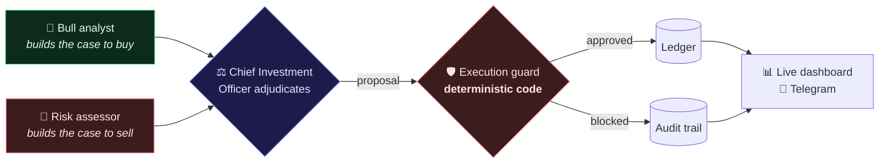

<a id="top"></a>

<div align="center">

# AlphaAgent

**An enterprise-grade AI investment platform with deterministic risk governance and
verifiable decision attribution.**

[](https://github.com/SergeyGer/AlphaAgent/actions/workflows/ci.yml)
[](https://github.com/SergeyGer/AlphaAgent/actions/workflows/codeql.yml)
[](https://github.com/SergeyGer/AlphaAgent/actions/workflows/docs.yml)
[](https://github.com/SergeyGer/AlphaAgent/wiki/Quality-and-Testing)
[](LICENSE)

**For:** product leaders and reviewers asking whether an LLM can be put in front of
real capital without trusting it, and AI engineers building systems that must answer
for their own decisions. **It answers three questions:** what the agent decided, why,
and — after the fact — whether it was right.

</div>

<details>
<summary><b>Contents</b> — 8 sections, ~7 min read, or jump straight to the code</summary>

| | |
| --- | --- |
| [**Business value**](#business-value-in-one-paragraph) | Why decoupling AI judgement from risk enforcement is the whole product |
| [**The three product pillars**](#the-three-product-pillars) | Decision attribution, the deterministic guard, the adversarial debate |
| [**Who this is for**](#who-this-is-for) | Four readers, and what each of them gets |
| [**Choose your path**](#choose-your-path) | Four tracks with reading times |
| [**See it running**](#see-it-running) | An 81-second walkthrough, the live demo, and the measured result |
| [**Run it yourself**](#run-it-yourself) | One command, ~5 minutes to a running stack |
| [**How it works in one minute**](#how-it-works-in-one-minute) | The request path, end to end |
| [**Under the hood**](#under-the-hood) | Stack, and links into the full technical wiki |
| [**Roadmap**](#roadmap) | What is deliberately not built yet |

</details>

---

## Business value, in one paragraph

Putting a language model in front of capital introduces three problems no prompt can
solve: the model is **non-deterministic**, it **hallucinates**, and its reasoning is
**not auditable** after the fact. AlphaAgent's answer is architectural rather than
rhetorical — it **decouples AI judgement from financial enforcement**. The agents may
argue whatever they like; a separate, hard-coded guard decides what is allowed to
touch the ledger, and every decision is scored afterwards against what the market
actually did. A black box becomes a system with a transcript, a cost and a grade.

---

## The three product pillars

Three claims, each of which a reviewer can check in this repository. Click one to
open the detail; all three stay shut by default.

<details>
<summary><b>1. Verifiable decision attribution</b> — every decision is scored against what the market did next &nbsp;·&nbsp; <code>HOLD included</code></summary>

Instead of hiding model performance, AlphaAgent treats transparency as the product
metric. Every decision — including every deliberate **HOLD** — is scored
retroactively against real market data at **1, 7 and 30 days**.

- **Continuous KPI tracking** — absolute return, directional hit rate, and alpha
  against SPY over the same window.
- **A complete audit trail** — every execution links back to the debate that produced
  it (`bull_case`, `bear_case`), the tokens consumed, and the API cost charged.
- **Why it matters** — it gives a stakeholder an honest, data-driven assessment of
  LLM return on investment, rather than a demo that only shows winning trades.

→ [Decision Attribution](https://github.com/SergeyGer/AlphaAgent/wiki/Decision-Attribution)

</details>

<details>
<summary><b>2. Deterministic risk guard</b> — the model never has the final say over capital &nbsp;·&nbsp; <code>pure function</code></summary>

A zero-trust execution guard wraps the AI layer and enforces institutional limits in
plain decimal arithmetic.

- **Hard enforcement** — per-trade allocation, available cash, position size, daily
  loss, cumulative portfolio exposure and single-instrument concentration.
- **Fail-safe by construction** — a pure function with no I/O. A malformed, corrupted
  or manipulated proposal is clamped or rejected before it can reach the ledger, and
  the refusal names the limit that bound.
- **Why it matters** — it converts "trust the AI" into "trust the arithmetic", which
  is a claim a risk committee can actually review.

→ [Execution Guard](https://github.com/SergeyGer/AlphaAgent/wiki/Execution-Guard)

</details>

<details>
<summary><b>3. Adversarial multi-agent architecture</b> — disagreement first, because one model agreeing with itself looks like confidence &nbsp;·&nbsp; <code>3 agents</code></summary>

Single-agent pipelines amplify hallucinations: one model agreeing with itself reads as
certainty. AlphaAgent forces disagreement first.

- **The debate** — a **Bullish Research Analyst** and a **Risk Assessor (Short
  Seller)** build opposing cases from live prices, news and filings.
- **The adjudicator** — a separate **Chief Investment Officer** agent weighs both and
  issues one structured proposal, so no single biased prompt dictates strategy.
- **Why it matters** — the transcript is the artefact a reviewer reads, and it is
  stored with the decision rather than summarised away.

→ [Agent Debate](https://github.com/SergeyGer/AlphaAgent/wiki/Agent-Debate)

</details>

---

## Who this is for

| Reader | What they get |
| --- | --- |
| **Product leaders and reviewers** | How a generative AI product is bounded, measured and kept accountable to business metrics rather than a demo reel |
| **AI engineers** | Production guardrails, multi-agent debate topology, and deterministic payload validation — the parts that stop an agent being a liability |
| **Fintech architects** | A reference for attaching proprietary data over MCP and streaming reasoning over WebSocket without exposing either to the model |
| **Infrastructure engineers** | A containerised multi-service stack with documented failure modes and an incident log written from real defects |

---

## Choose your path

Four tracks. **Click yours** — the detail opens underneath, and nothing else does.

<details>
<summary><b>📊 I manage money</b> — risk controls, and what the system has actually scored &nbsp;·&nbsp; <code>15 min</code></summary>

You care whether the risk controls are real and whether it makes money. It does
not, yet, and that is published.

| Step | Read | Time |
| --- | --- | --- |
| 1 | [The measured scorecard](https://github.com/SergeyGer/AlphaAgent/wiki/Decision-Attribution) — hit rate, alpha, and how a decision is scored | **4 min** |
| 2 | [The execution guard](https://github.com/SergeyGer/AlphaAgent/wiki/Execution-Guard) — the six limits, clamp vs. refuse | **5 min** |
| 3 | [Position theses](https://github.com/SergeyGer/AlphaAgent/wiki/Position-Thesis) — why a position is held, and what would falsify it | **3 min** |
| 4 | [INC-001](https://github.com/SergeyGer/AlphaAgent/wiki/Incident-Log#inc-001--overlapping-sweeps-bought-the-same-stock-twice) — the over-concentration a per-trade limit did not catch | **3 min** |

**Skip** everything about CrewAI, Docker and React.

</details>

<details>
<summary><b>🤖 I build with LLMs</b> — how model output is constrained, and what happens when it is wrong &nbsp;·&nbsp; <code>16 min</code></summary>

The interesting claim is that the model never gets the final say.

| Step | Read | Time |
| --- | --- | --- |
| 1 | [LLM quality and guardrails](https://github.com/SergeyGer/AlphaAgent/wiki/LLM-Quality-and-Guardrails) — the seven layers, with line-numbered code | **7 min** |
| 2 | [The agent debate](https://github.com/SergeyGer/AlphaAgent/wiki/Agent-Debate) — bull, bear, CIO, and the output contract | **4 min** |
| 3 | `ai_agent.py` — [`TradeProposal`](https://github.com/SergeyGer/AlphaAgent/blob/main/ai_agent.py#L87) and [`parse_proposal`](https://github.com/SergeyGer/AlphaAgent/blob/main/ai_agent.py#L160) | **3 min** |
| 4 | [Model compatibility](https://github.com/SergeyGer/AlphaAgent/wiki/Configuration) — why Haiku 5.5 rejects `temperature` | **2 min** |

**The one idea worth taking away:** `parse_proposal` returns `None` rather than
defaulting to `HOLD`, because a default is indistinguishable in the audit trail
from a decision the model never made.

</details>

<details>
<summary><b>🔧 I run infrastructure</b> — topology, failure modes, and how it is kept from becoming an incident &nbsp;·&nbsp; <code>17 min</code></summary>

| Step | Read | Time |
| --- | --- | --- |
| 1 | [Operations](https://github.com/SergeyGer/AlphaAgent/wiki/Operations) — services, scheduled jobs, branch rules | **6 min** |
| 2 | [INC-010](https://github.com/SergeyGer/AlphaAgent/wiki/Incident-Log#inc-010--both-databases-were-reachable-from-the-public-internet) — two databases exposed to the internet for two weeks | **4 min** |
| 3 | [Configuration](https://github.com/SergeyGer/AlphaAgent/wiki/Configuration) — every environment variable | **4 min** |
| 4 | [`CONTRIBUTING.md`](CONTRIBUTING.md) and [`.devcontainer/`](.devcontainer/README.md) | **3 min** |

`make start` / `make down`, and nothing auto-starts on reboot.

</details>

<details>
<summary><b>🎯 I am reviewing the work</b> — a few minutes, judging the engineering &nbsp;·&nbsp; <code>18 min</code></summary>

| Step | Read | Time |
| --- | --- | --- |
| 1 | [▶ Watch the walkthrough](#see-it-running) — one 81-second video, real dashboard, real numbers | **1.5 min** |
| 2 | [Incident log](https://github.com/SergeyGer/AlphaAgent/wiki/Incident-Log) — ten real defects, root causes and fixes | **8 min** |
| 3 | [ADR index](docs/adr/README.md) — sixteen decisions with the alternatives that were rejected | **6 min** |
| 4 | [Quality signals](#quality-signals) — what each gate actually proves | **2 min** |

</details>

---
## See it running

[](docs/demo-walkthrough.mp4)

**▶ [Watch the walkthrough](docs/demo-walkthrough.mp4)** — one 81-second video, narrated and
recorded from the running system. The dashboard, the AI debate, the risk guard, and the
scorecard it publishes.

### ▶ [Try the live demo](https://alphaagent-6stcj667tqeawiupedhygh.streamlit.app/) — the real UI in a browser, no installation and no API keys


*Recorded from the live system — sign-in, portfolio metrics, the equity curve, an
agent debate expanding, news sentiment and the trade ledger.*

### The headline metric: decision attribution

AlphaAgent scores itself. Every decision — including every deliberate **HOLD** — is
replayed against what the market actually did next, at **1, 7 and 30 day** horizons,
and the scorecard is shown on the dashboard for any visitor to read.

It tracks three things, and counts them separately for the long side so a good average
cannot hide bad BUY calls:

| Tracked | The question it answers |
| --- | --- |
| **Directional hit rate** | Was the call right in direction? |
| **Forward return** | What was the decision actually worth? |
| **Alpha vs SPY** | Did it beat simply holding the benchmark over the same window? |

**The figures are not flattering, and they are published anyway.** A performance
number that can only ever produce good news is not a measurement; it is marketing.
The scorecard is the feature, not the demo — it is what lets a reader judge the system
instead of taking its word.

> **What the audit trail adds:** every figure traces back to a stored decision row —
> both sides of the argument that produced it (`bull_case`, `bear_case`), the tokens
> consumed and the API cost charged. A number you cannot trace is a number you cannot
> defend.

The current scorecard, the method behind it, and the flaw I found in my own scoring —
one that made the figures *worse* — live in
[Decision Attribution](https://github.com/SergeyGer/AlphaAgent/wiki/Decision-Attribution).
It is kept in one place on purpose: a number quoted in several files is a number that
will eventually disagree with itself.

<details>
<summary><b>More screenshots</b> — dashboard, decision quality, risk ceilings, debate, mobile</summary>

**The dashboard.** Equity curve, asset allocation, the stream of agent reasoning, pending approvals, trades, and news scored positive/negative.


**Decision quality.** Every decision scored against what the market did next — hit rate, average return and alpha against SPY at 1, 7 and 30 days, with the individual outcomes behind the aggregate. The numbers are unflattering and shown as measured.


**Risk ceilings.** Invested capital against the portfolio exposure limit, and the largest position against the single-instrument concentration limit — the check that caught a real over-concentration in this demo portfolio.


**Position theses.** The standing reason for holding each position and the condition that would prove it wrong — the same text the agents receive on every run, so an exit has to argue with the reason for entry.


**The debate view.** Expand any decision to read the bull case, the bear case and the adjudicator's verdict side by side.


**Mobile.** The same dashboard at a 414 px viewport.


</details>

<p align="right"><sub><a href="#top">↑ back to top</a></sub></p>

---

## Run it yourself

**Try the risk guard without an account, a key or a database:**

[](https://alphaagent-6stcj667tqeawiupedhygh.streamlit.app)

A single page that drives the project's **real risk guard** — the same
`services/execution.py` the live system runs — so you can push the sliders until
it refuses a trade and read its actual reason string.

If the hosted demo is not up, run the identical thing locally in two commands:

```bash
pip install -r demo/requirements.txt
streamlit run demo/app.py
```

**Or run the whole stack.** Two commands, no build step — the image is published
to GHCR:

```bash
docker compose -f docker-compose.ghcr.yml up
```

The port defaults to **8080**, not 8000, because this stack is rarely the only
thing on a machine and a collision is silent until a bind fails. Override it
with `ALPHA_WEB_PORT`: `ALPHA_WEB_PORT=9000 docker compose up -d`.

Nothing in the stack restarts itself. No service uses `restart: always` or
`unless-stopped`, so a server reboot does not silently bring the demo back -
and does not resume autonomous trading without anyone asking. Start it when
you want it.

Open **<http://127.0.0.1:8080/>** and sign in as `demo` / `demo-pass-123`. The
demo credentials are committed on purpose so the stack starts with no
configuration at all; they are demo values, not secrets.

No API key is needed either — without one a deterministic engine keeps the whole
pipeline running so you can explore it offline.

<details>
<summary>Prefer to build from source?</summary>

```bash
git clone https://github.com/SergeyGer/AlphaAgent.git
cd AlphaAgent

cp .env.example .env
# Set DJANGO_SECRET_KEY and POSTGRES_PASSWORD (generate one with:
#   python3 -c "import secrets; print(secrets.token_urlsafe(64))")

docker compose up -d --build
docker compose exec web python manage.py seed_demo
```

</details>

To enable live AI reasoning, add an `AI_LLM_API_KEY` to `.env`. Full
configuration reference: [Configuration](https://github.com/SergeyGer/AlphaAgent/wiki/Configuration).

<p align="right"><sub><a href="#top">↑ back to top</a></sub></p>

## How it works in one minute



**Why three agents and not one?** A single analyst feeding a single
decision-maker is a hallucination amplifier — whatever the analyst asserts
becomes the premise, and nothing argues the other side. Here a bull and a short
seller work from *different evidence* and are explicitly instructed to concede
when their case is weak. The short seller in one live run reported that it
"cannot build a credible bear case for Apple at current levels" — and the final
verdict cited that admission.

**Why a guard instead of trusting the model?** Position size, available cash,
concentration and the daily stop-loss are enforced in a pure function that is
unit-tested and has no knowledge of language models. The AI proposes; the code
decides. If the model is wrong, confused, or actively manipulated, the worst it
can do is make a suggestion that gets rejected.

<p align="right"><sub><a href="#top">↑ back to top</a></sub></p>

## Under the hood

For reviewers who want the detail, the full engineering documentation lives in
the wiki:

| | |
| --- | --- |
| [**Architecture**](https://github.com/SergeyGer/AlphaAgent/wiki/Architecture) | System design, service topology, the decision pipeline end to end |
| [**Agent Debate**](https://github.com/SergeyGer/AlphaAgent/wiki/Agent-Debate) | How the three agents are prompted and why adversarial beats sequential |
| [**LLM Quality & Guardrails**](https://github.com/SergeyGer/AlphaAgent/wiki/LLM-Quality-and-Guardrails) | How model output is validated, bounded and measured - and what the approach cannot prove |
| [**Decision Attribution**](https://github.com/SergeyGer/AlphaAgent/wiki/Decision-Attribution) | Every decision scored against what the market did next: hit rate, alpha vs SPY, 1/7/30-day horizons |
| [**Position Thesis**](https://github.com/SergeyGer/AlphaAgent/wiki/Position-Thesis) | Why a position is held and what would falsify it, fed back to the agents as prior belief |
| [**Execution Guard**](https://github.com/SergeyGer/AlphaAgent/wiki/Execution-Guard) | The risk model, its invariants, and why it is deterministic code |
| [**Data Model**](https://github.com/SergeyGer/AlphaAgent/wiki/Data-Model) | Schema, the derived ledger, concurrency control |
| [**Real-Time Layer**](https://github.com/SergeyGer/AlphaAgent/wiki/Real-Time-Layer) | WebSocket authentication, event model, reconnection |
| [**API Reference**](https://github.com/SergeyGer/AlphaAgent/wiki/API-Reference) | Every endpoint, with request and response shapes |
| [**Operations**](https://github.com/SergeyGer/AlphaAgent/wiki/Operations) | Runbook, scheduled jobs, failure modes |
| [**Engineering Decisions**](https://github.com/SergeyGer/AlphaAgent/wiki/Engineering-Decisions) | The trade-offs behind each significant choice |
| [**Architecture Decision Records**](docs/adr/README.md) | Sixteen decisions, each with the alternatives that were rejected |
| [**Incident Log**](https://github.com/SergeyGer/AlphaAgent/wiki/Incident-Log) | Real defects, root-cause analysis and the fixes |
| [**Quality & Testing**](https://github.com/SergeyGer/AlphaAgent/wiki/Quality-and-Testing) | Test strategy, CI pipeline, security scanning |

**The stack, in detail:**

[](https://www.python.org/)
[](https://www.djangoproject.com/)
[](https://www.postgresql.org/)
[](https://redis.io/)
[](https://docs.celeryq.dev/)
[](https://www.crewai.com/)
[](https://react.dev/)
[](https://www.typescriptlang.org/)
[](https://tailwindcss.com/)
[](https://docs.docker.com/compose/)

**Also in the stack:** Django REST Framework · Django Channels (WebSockets) ·
Recharts · GitHub Actions

<a href="#top">↑ back to top</a>

## Roadmap

Tracked as issues, so each can be discussed and claimed:
[deployment ceilings](https://github.com/SergeyGer/AlphaAgent/issues/27) ·
[backtesting](https://github.com/SergeyGer/AlphaAgent/issues/28) ·
[decision replay](https://github.com/SergeyGer/AlphaAgent/issues/29) ·
[per-user strategies](https://github.com/SergeyGer/AlphaAgent/issues/30) ·
[hosted instance](https://github.com/SergeyGer/AlphaAgent/issues/31) ·
[more asset classes](https://github.com/SergeyGer/AlphaAgent/issues/32).
Three further proposals come from comparing the project against
[TradingAgents](https://github.com/TauricResearch/TradingAgents):
[point-in-time data](https://github.com/SergeyGer/AlphaAgent/issues/33),
[a live scorecard](https://github.com/SergeyGer/AlphaAgent/issues/34) and
[verifiable audit bundles](https://github.com/SergeyGer/AlphaAgent/issues/35).

Full roadmap and rationale: [Roadmap](https://github.com/SergeyGer/AlphaAgent/wiki/Roadmap).

---

<div align="center">

**[Full technical wiki →](https://github.com/SergeyGer/AlphaAgent/wiki)**

MIT licensed · see [LICENSE](LICENSE) · contributions welcome, see [CONTRIBUTING.md](CONTRIBUTING.md)

</div>

<!--
Note to future maintainers: this README is deliberately aimed at a non-specialist
reader. Implementation detail belongs in the wiki, not here. If you are about to
add a code sample, an API table or an architecture diagram, it probably belongs on
the corresponding wiki page instead. Keep this file scannable in under two minutes.
-->
