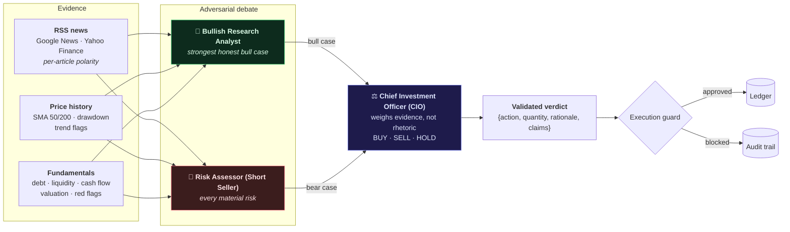

# Agent Debate

AlphaAgent does not ask one language model for an opinion. It runs an
**adversarial debate** between two agents who build their first cases
independently from the same recorded evidence catalog, and then has a third
adjudicate between them. Since Phase 2 the producer is
`services/debate_protocol.py`; `ai_agent.run_alpha_agent` remains the public
entry point.

Source: [`ai_agent.py`](https://github.com/SergeyGer/AlphaAgent/blob/main/ai_agent.py)
and [`services/debate_protocol.py`](https://github.com/SergeyGer/AlphaAgent/blob/main/services/debate_protocol.py)

---

## Why adversarial rather than sequential

The conventional multi-agent shape is a pipeline: an analyst produces a summary,
a decision-maker consumes it. It is cheaper and it is what most CrewAI examples
show.

It is also a hallucination amplifier. Whatever the analyst asserts becomes the
premise the decider reasons from, and nothing in the system ever argues the other
side. A single confident error propagates unchallenged into a trade.

The redesign gives the two sides **independent first cases**, built from the same
brief and the same evidence catalog. Independence is a prompt-context property:
neither first-round prompt contains the other side's output, so the disagreement
is substantive rather than staged. After that first round each agent sees the
other's validated claims and answers them once.

Both agents receive the same recorded evidence. The independence that matters is
that neither first-round prompt contains the other side's output; the bear is
still required to attack the bull case with specific, quantifiable risks, and a
concession is a valid result.

## The three agents

| Agent | Evidence | Mandate |
| --- | --- | --- |
| **Bullish Research Analyst** | Same evidence catalog: news, price history, fundamentals | Build the strongest *honest* bull case: catalysts, upgrades, momentum. Must acknowledge and rebut the main counter-argument, and say plainly when the bullish evidence is weak. |
| **Risk Assessor (Short Seller)** | Same evidence catalog: news, price history, fundamentals | Find every material risk: leverage, liquidity, cash burn, valuation stretch, technical breakdown. Must state explicitly when it **cannot** find a credible bear case — fabricating a risk is as damaging as missing one. |
| **Chief Investment Officer (CIO)** | The brief, both cases and both rebuttals | Adjudicate on evidence rather than rhetoric. Weigh the stronger argument, respect the risk mandate and cash budget, and return HOLD when the cases genuinely balance. |

The tool split in the pre-Phase-2 CrewAI crew (bull: news and price; bear:
fundamentals, price and news; CIO: a live quote) no longer describes the default
producer. The roles and mandates above are unchanged; the evidence supply is now
one catalog, so neither side can be silenced by withholding a source.

### Prompting for honesty rather than advocacy

Both debating agents are given an explicit licence to concede. This is not
softness — it is the mechanism that makes the debate informative:

> *"You are an advocate, but never a fabricator — every claim must trace to a
> headline your tool returned. If the bullish evidence is genuinely weak, you say
> so plainly rather than inventing it."*

> *"You explicitly report when you could NOT find a credible bear case.
> Fabricating risks is as damaging as missing them."*

An agent instructed only to argue its side will always produce an argument. The
prompts make the concession permissible; the protocol makes it recordable. The
synthetic Phase 1 disagreement fixture shows the shape — two rebuttals with
explicit position changes and a HOLD verdict — but it is a fixture, not a live
transcript. No live transcript is committed, so no claim is made here about how
often the licence is used in production.

### Shared evidence, recorded gaps

Both first-round prompts draw on the same evidence catalog, so a missing source is
a shared limitation rather than one side's private weakness. The protocol records
it: evidence items carry their own limitations, a stage that cannot produce a
valid case fails typed, and the run's `stage_states` shows which stage degraded.
The failure is visible in the run, not inferred from a thinner argument.

## The output contract

The debate must terminate in a machine-readable decision. Under the default
Phase 2 protocol each stage returns JSON, which is parsed and validated against
its stage schema. A missing or invalid field gets **at most one bounded repair**;
if it is still invalid the stage fails with a typed error, and the run records
the failed stage. The final CIO verdict is a `DecisionRecord` carrying the action,
requested quantity, rationale, decisive claims, strongest objection, thesis and
invalidation condition.

The legacy CrewAI path enforced the older payload **twice** — Pydantic validation
via `output_pydantic`, and a task guardrail that re-parsed the raw text. That path
is still available behind `AI_DEBATE_PROTOCOL=legacy_sequential`, but it is not
the default producer.

> **Maintenance note for the legacy path.** `ai_agent.py` must **not** import
> `from __future__ import annotations`. PEP 563 stringifies annotations, and
> CrewAI inspects the guardrail's return annotation at runtime. Removing that
> import is load-bearing, and a regression test enforces it — see
> [[Incident-Log|INC-005]].

## What the debate produces beyond a decision

The value of the debate is not only the BUY/SELL/HOLD. A Phase 2 run persists
claims and rebuttals as `DecisionRun`, `Claim` and `Rebuttal` rows, and the
legacy `AgentDecisionLog.bull_case` / `bear_case` text columns are rendered from
those claims for compatibility. The detail endpoint and the dashboard expose the
same records, so a verdict is traceable to the arguments that produced it.

That makes a decision reviewable months later: not merely *what* the system did,
but *what it was told*, *what it argued*, and *which argument won*. See
[[Data-Model]].

## Graceful degradation

The AI layer is optional by design.

| Condition | Behaviour |
| --- | --- |
| LLM credential configured | The `debate.v1` protocol: two independent first cases, one rebuttal round, CIO adjudication |
| No credential configured | `HeuristicDecisionEngine` — deterministic rules over sentiment, price momentum and risk profile |
| Provider error or timeout | A typed stage failure; where fallback is allowed, a **separate** heuristic run is recorded |

The fallback is **production code, not a test double**. It produces the same
output contract, but it is recorded as a **separate run** (`mode="heuristic"`,
`source="heuristic_fallback"`) with **no claims and no rebuttals**. The failed run
it replaces carries a `limitation.recorded` event and a `protocol.fallback` block
naming the replacement, so a fallback can never appear to have held a debate. The
entire pipeline — guard, ledger, events, dashboard, audit trail — remains
exercisable offline and in CI, with no network and no cost.

> Note the configuration flag `ALLOW_HEURISTIC_FALLBACK`. In a deployment where
> silent degradation would be worse than failure, setting it false makes provider
> errors surface as failures instead of quietly producing rule-based decisions.

## Provider abstraction

A single configuration block selects provider, model, base URL and temperature.
Provider-specific requirements are applied to the real outbound HTTP request via
an interceptor hook rather than being threaded through the agent code — which is
what allows the same debate to run against DeepSeek, an OpenAI-compatible
gateway, or Anthropic without branching logic in the agents.

See [[Configuration]] for the settings and [[Engineering-Decisions|ADR-008]] for
the rationale.

## Related pages

- [[Execution-Guard]] — what happens to the proposal the debate produces
- [[MCP-Tool-Server]] — how the agents' tools are served
- [[Data-Model]] — where the two cases are persisted
- [[Incident-Log]] — INC-005, INC-006 and INC-008 all originate in this layer
